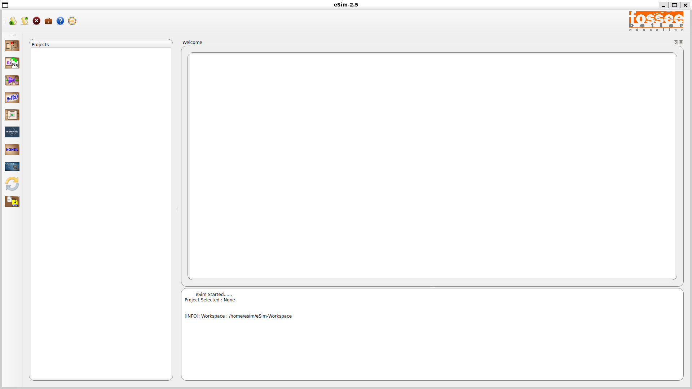

# Installing eSim 2.5 on Ubuntu 25.04: problems found, fixes, and verification

**Task 4 — eSim Upgradation (CSE and related fields)**
FOSSEE Semester Long Internship, Autumn 2026

| | |
|---|---|
| **Submitted by** | Kondeti Sri Datta Sidhardha |
| **Roll number** | 246T1A05D3 |
| **Institute** | Pydah College of Engineering |
| **GitHub** | [@siddu-k](https://github.com/siddu-k) |
| **Fork / branch** | `https://github.com/siddu-k/eSim/tree/installers-ubuntu-25.04` |
| **Report date** | 2026-11-22 |
| **eSim version** | 2.5 (`VERSION` = `2.5`, archive `eSim-2.5.zip`, 100,868,880 bytes) |
| **Test OS** | Ubuntu 25.04 (Plucky Puffin), WSL2 kernel 6.18, Python 3.13.3, GCC 14.2.0 |
| **Base files** | FOSSEE/eSim, branch `installers` (installer scripts) |

---

## 1. Executive summary

eSim 2.5 **cannot be installed on Ubuntu 25.04 out of the box**. The shipped
archive's installer does not know that release and exits before doing anything:

```
$ chmod +x install-eSim.sh
$ ./install-eSim.sh --install
Detected Ubuntu Version:
Unsupported Ubuntu version: 25.04 ()
```

Even after adding 25.04 support (which exists on the `installers` branch), the
install still fails at four independent points, each of which had to be fixed:

1. the Python dependency step dies on `hdlparse` (`use_2to3 is invalid`);
2. NGHDL cannot build GHDL because Ubuntu 25.04 ships LLVM 20, which
   GHDL 4.1.0 rejects;
3. `libcanberra-gtk-module` no longer exists on 25.04;
4. the very last step copies a desktop file into `~/Desktop`, which does not
   exist on a fresh/minimal install.

On top of those blockers, the eSim KiCad symbol library was installed into a
directory KiCad 8 never reads (and with an environment variable KiCad 8 does not
define), so even a "successful" install could not be used to draw schematics.

**Result of this work:** 16 issues documented, **14 fixed**, 1 hardened, 1
documented as an environment note. A clean Ubuntu 25.04 install now completes
end-to-end and the GUI starts. The complete toolchain is verified:
eSim GUI, KiCad 8, GHDL 4.1.0 (LLVM 18), Verilator 4.210, ngspice 35, SKY130 PDK.

| Metric | Count |
|---|---|
| Issues found | 16 |
| Blockers of the main GUI / simulator | 4 (I-01, I-02, I-03, I-04) |
| Fixed | 14 |
| Hardened | 1 (I-14) |
| Environment notes | 1 (I-16) |
| Files changed | 4 scripts + this report |
| Clean install verified | Yes (WSL2 Ubuntu 25.04, 12 vCPU) |

---

## 2. Environment and artifacts

### 2.1 Machine

| Item | Value |
|---|---|
| OS | Ubuntu 25.04 (Plucky Puffin), x86_64 |
| Kernel | 6.18.33.2-microsoft-standard-WSL2 |
| Display | WSLg (`DISPLAY=:0`) — the real GUI was used for verification |
| Python | 3.13.3 |
| GCC / GNAT | 14.2.0 / 14.1 |
| llvm (default) | 20.1.2 (`llvm` 1:20.0-63ubuntu1) |
| llvm-18 (installed by fix) | 18.1.8 (`llvm-18` 1:18.1.8-17) |
| KiCad | 8.0.8+dfsg-1 (Ubuntu `universe`) |
| GHDL | 4.1.0, LLVM 18 backend |
| Verilator | 4.210 |
| ngspice | 35 (NGHDL build) |

### 2.2 Inputs

* eSim 2.5: <https://static.fossee.in/esim/installation-files/eSim-2.5.zip>
  (SHA-256 in Appendix B).
* Installer reference: `FOSSEE/eSim`, branch `installers`
  (`Ubuntu/install-eSim.sh` and `Ubuntu/install-eSim-scripts/`).
* NGHDL installer: `nghdl.zip` shipped inside `eSim-2.5.zip`
  (`nghdl/install-nghdl.sh` + `nghdl/install-nghdl-scripts/`).
* Ubuntu 25.04 rootfs for WSL:
  `cloud-images.ubuntu.com/releases/plucky/release-20260114/`.

### 2.3 Deliverables in this folder

Paths as committed in the fork (`installers-ubuntu-25.04` branch):

```
Ubuntu/
├── install-eSim.sh                        fixed version dispatcher
├── install-eSim-scripts/
│   └── install-eSim-25.04.sh              fixed per-release installer
├── nghdl/                                 fixed NGHDL installer (for review)
│   ├── install-nghdl.sh
│   └── install-nghdl-scripts/
│       └── install-nghdl-25.04.sh
├── patches/                               unified diffs vs. the shipped files
├── screenshots/                           evidence (fig01, fig02)
└── REPORT.md                              this document
```

---

## 3. Methodology

1. **Clean-room reproduction.** Ubuntu 25.04 imported into WSL2 from Canonical's
   official cloud rootfs, so nothing from the host Ubuntu 26.04 leaks in.
   `tools/00-collect-baseline.sh` records OS, Python, package candidates and
   disk space before any change.
2. **Reproduce the shipped behaviour first.** `tools/01-reproduce-original.sh`
   runs the *unmodified* `install-eSim.sh` and the *unmodified* NGHDL installer
   and saves their exact output.
3. **Isolate one variable at a time.** Package availability was checked with
   `apt-cache policy`/Launchpad instead of guessing; the LLVM problem was
   reduced to a 20-line GHDL `configure` run with LLVM 20 and then LLVM 18
   (`tools/02-verify-llvm.sh`). A suspected Verilator/GCC-14
   failure was tested and **ruled out** (§7), so it is not claimed as a bug.
4. **Patch, then re-run the real installer.** Fixes were applied with
   `tools/apply-patches.sh` to an extracted `eSim-2.5` tree and the complete
   install was executed again with a full transcript
   (`tools/run-install.sh` → `~/esim-install-*.log`).
5. **Verify with an acceptance script.** `tools/verify-install.sh` checks 23
   properties (application files, Python imports, KiCad symbol registration,
   ngspice/GHDL/Verilator, SKY130 PDK) and prints PASS/FAIL.
6. **Prove the GUI.** `esim` was launched under WSLg and verified with the
   workspace selector and main GUI windows (Figure 1, Figure 2).

The command trail is reproducible end-to-end; see §10.

---

## 4. Baseline evidence (before any fix)

`tools/00-collect-baseline.sh` on the clean image:

```
PRETTY_NAME="Ubuntu 25.04"
VERSION_ID="25.04"
VERSION_CODENAME=plucky
Python 3.13.3
lsb_release : Ubuntu 25.04

Package availability (apt-cache policy, "candidate"):
kicad                        8.0.8+dfsg-1
kicad-libraries              8.0.8+dfsg-1
llvm                         1:20.0-63ubuntu1
llvm-dev                     1:20.0-63ubuntu1
llvm-18                      1:18.1.8-17
llvm-18-dev                  1:18.1.8-17
gnat                         14.1ubuntu1
libcanberra-gtk-module       (none)
libcanberra-gtk3-module      0.30-17ubuntu2
libncurses5-dev              (virtual: libncurses-dev)
python3-distutils            (none)
python3-setuptools           75.8.0-1ubuntu1
kicad package in universe    8.0.8+dfsg-1
/usr/bin/llvm-config --version : 20.1.2
```

This single output explains three of the bugs below: the default LLVM is 20,
the GTK2 canberra module is gone, and KiCad 8 (not 6) is the release in the
archive.

---

## 5. Issue catalogue

| ID | Area | Symptom | Severity | Status |
|----|------|---------|----------|--------|
| I-01 | eSim installer | `Unsupported Ubuntu version: 25.04` | **Blocker** | Fixed |
| I-02 | NGHDL installer | `Unsupported Ubuntu version: 25.04` | **Blocker** | Fixed |
| I-03 | Python deps | `error in hdlparse setup command: use_2to3 is invalid` | **Blocker** | Fixed |
| I-04 | GHDL build | `Unhandled version llvm 20.1.2` | **Blocker** | Fixed |
| I-05 | GHDL deps | `libcanberra-gtk-module` has no installation candidate | High | Fixed |
| I-06 | Launcher | `cp: cannot create ... /home/user/Desktop/esim.desktop` | High | Fixed |
| I-07 | KiCad symbols | Symbols installed to `~/.config/kicad/6.0`; `KICAD6_SYMBOL_DIR` undefined in KiCad 8 | High | Fixed |
| I-08 | Installer flow | `exit 0` inside `installKicad()` aborts re-installs | High | Fixed |
| I-09 | KiCad source | PPA 8.0.9 needs `libgit2-1.8` (not in 25.04) + brittle exact pin | Medium | Fixed |
| I-10 | Version detect | `Detected Ubuntu Version:` is empty | Medium | Fixed |
| I-11 | Uninstall | `rm -rf /usr/share/kicad` deletes KiCad's libraries | Medium | Fixed |
| I-12 | Python deps | duplicate Qt installs, moving `master` ref, optional tools fatal | Medium | Fixed |
| I-13 | Unattended use | missing `-y` / interactive `read` hangs scripts | Low | Fixed |
| I-14 | Verilator tarball | stale `config.status`/`Makefile` with `/home/avinash` paths | Low | Hardened |
| I-15 | ngspice deps | 24.04 list incomplete for a minimal 25.04 image | Low | Fixed |
| I-16 | OS lifecycle | Ubuntu 25.04 EOL 2026-01-15 | Info | Documented |

---

## 6. Detailed findings and fixes

### I-01 — eSim 2.5 rejects Ubuntu 25.04 (Blocker)

**Symptom.** The installer exits immediately; no package is touched.

```console
$ cd eSim-2.5
$ chmod +x install-eSim.sh
$ ./install-eSim.sh --install
Detected Ubuntu Version:
Unsupported Ubuntu version: 25.04 ()
```

**Root cause.** `install-eSim.sh` dispatches on `VERSION_ID` with cases for
22.04, 23.04 and 24.04 only. The archive ships
`install-eSim-scripts/{22.04,23.04,24.04}.sh` — there is no 25.04 script to
dispatch to (the `installers` branch added one, but the 2.5 release predates
that).

**Fix.** Add 25.04 (and 25.10) to the dispatcher and ship
`install-eSim-scripts/install-eSim-25.04.sh`:

```bash
"25.04")
    SCRIPT="$script_dir/install-eSim-25.04.sh"
    ;;
"25.10")
    echo "Ubuntu 25.10 detected: using the 25.04 profile (closest tested release)."
    SCRIPT="$script_dir/install-eSim-25.04.sh"
    ;;
*)
    # newer releases can opt in explicitly:
    #   ESIM_FORCE_PROFILE=25.04 ./install-eSim.sh --install
```

**Verification.** The installer now reaches the dependency phase:

```console
Detected Ubuntu Version: 25.04 (VERSION_ID=25.04)
Running script: /home/esim/eSim-2.5/install-eSim-scripts/install-eSim-25.04.sh --install
```

The complete transcript confirms the full run and its success banner.

---

### I-02 — The bundled NGHDL installer also rejects 25.04 (Blocker)

**Symptom.** Even with I-01 fixed, the install stops as soon as NGHDL runs:

```console
$ cd nghdl && ./install-nghdl.sh --install
Detected Ubuntu Version:
Unsupported Ubuntu version: 25.04 ()
```

**Root cause.** Same dispatch table, and `nghdl.zip` contains only
`install-nghdl-{22.04,23.04,24.04}.sh`.

**Fix.** Add the case to `nghdl/install-nghdl.sh` and add a new
`install-nghdl-scripts/install-nghdl-25.04.sh` (I-04, I-05, I-14, I-15 are all
in that file).

**Why this is high impact.** NGHDL is what builds **ngspice**. Without it eSim
opens, draws schematics, and cannot simulate anything.

---

### I-03 — `pip install hdlparse` aborts the dependency step (Blocker)

**Symptom.** After the version dispatch is fixed, the install dies in
`installDependency()`:

```console
Installing Hdlparse / Pyhdlparser..........
Collecting hdlparse
  Downloading hdlparse-1.0.4.tar.gz (10 kB)
  ...
  × Getting requirements to build wheel did not run successfully.
  ╭─> [1 lines of output]
      error in hdlparse setup command: use_2to3 is invalid.
      [end of output]
ERROR: Failed to build 'hdlparse' when getting requirements to build wheel
[eSim] FAILED at line 61: python -m pip install --disable-pip-version-check hdlparse (exit 1)
```

**Root cause.** The PyPI project `hdlparse` has not been released since 1.0.4
(2018); its `setup.py` sets `use_2to3 = True`. `setuptools` removed the
`use_2to3` option in version 58 (2021). Ubuntu 25.04's `python3-virtualenv`
seeds **setuptools 75.8.0** into the new environment, so the build fails
deterministically. This is a *new* blocker that only appears once I-01 is fixed.

**Fix.** Do not install the dead package. `hdlparse` and `pyhdlparser` are the
same project: `pyhdlparser` is the maintained repository and installs the
`hdlparse` module (1.0.7). The installer already downloads it; the second
`pip install hdlparse` line is simply removed and the surviving install is
pinned to a commit:

```bash
# [FIX 7] pyhdlparser IS the maintained hdlparse: same `hdlparse` module.
PYHDLPARSER_REF="e1153ace8ca1e25f9fb53350c41058ef8eb8dacf"
python -m pip install --disable-pip-version-check \
    "https://github.com/hdl/pyhdlparser/tarball/$PYHDLPARSER_REF"
```

**Verification.**

```console
$ ~/.esim/env/bin/pip install "https://github.com/hdl/pyhdlparser/tarball/e1153..."
  Created wheel for hdlparse: filename=hdlparse-1.0.7-py3-none-any.whl
Successfully installed hdlparse-1.0.7

$ ~/.esim/env/bin/python -c "import hdlparse.verilog_parser as v; print('OK')"
hdlparse package path : /home/esim/.esim/env/lib/python3.13/site-packages/hdlparse/__init__.py
OK
```

`tools/05-verify-pyhdlparser.sh` reproduces this check.

---

### I-04 — GHDL 4.1.0 cannot build against LLVM 20 (Blocker for simulation)

**Symptom.** NGHDL's GHDL build fails during `configure`:

```console
$ ./configure --with-llvm-config=/usr/bin/llvm-config
Build machine is: x86_64-linux-gnu
Unhandled version llvm 20.1.2
$ echo $?
1
```

**Root cause.** Ubuntu 25.04's `llvm`/`llvm-dev` are **20.0**. GHDL 4.1.0
(December 2024) supports LLVM up to the 18 series; its `configure` has an
explicit version table and exits on anything newer. The eSim 2.5 NGHDL script
installs the unversioned packages and therefore always picks LLVM 20 on 25.04.

**Fix.** Install the still-packaged LLVM 18 and point GHDL at the versioned
config tool:

```bash
sudo apt-get install -y llvm-18 llvm-18-dev
./configure --with-llvm-config=/usr/bin/llvm-config-18
```

The script also fails early with an actionable message if
`/usr/bin/llvm-config-18` is missing.

**Verification** (`tools/02-verify-llvm.sh`):

```console
configure with LLVM 20 (/usr/bin/llvm-config):    exit=1   Unhandled version llvm 20.1.2
configure with LLVM 18 (/usr/bin/llvm-config-18): exit=0
/usr/bin/llvm-config-18 --version: 18.1.8
```

After installation, `ghdl --version` reports the LLVM 18 code generator.

---

### I-05 — `libcanberra-gtk-module` was removed in 25.04 (High)

**Symptom.** The NGHDL dependency step aborts:

```console
$ sudo apt-get install -y libcanberra-gtk-module libcanberra-gtk3-module
E: Package 'libcanberra-gtk-module' has no installation candidate
```

because the script runs with `set -e` and an `ERR` trap.

**Root cause.** Ubuntu 25.04 dropped the GTK2 build of libcanberra. Only
`libcanberra-gtk3-module` (0.30-17ubuntu2) exists; `apt-cache policy` reports
`(none)` for the GTK2 package.

**Fix.** Install only the GTK3 module (eSim/Qt does not need the GTK2 one):

```bash
sudo apt-get install -y libcanberra-gtk3-module
```

**Verification.** The dependency step completes and the transcript shows the
gtk3-only line.

---

### I-06 — The last install step writes to a non-existent `~/Desktop` (High)

**Symptom.** On a fresh 25.04 (WSL, server or minimal desktop) there is no
`Desktop` directory. `createDesktopStartScript()` runs under `set -e`:

```console
$ ls -ld ~/Desktop
ls: cannot access '/home/esim/Desktop': No such file or directory

cp: cannot create regular file '/home/esim/Desktop/esim.desktop': No such file or directory
[eSim] FAILED at line ...: cp -vp esim.desktop $HOME/Desktop/
```

So an otherwise complete installation aborts at the final step, after KiCad,
NGHDL and the PDK have all been built.

**Root cause.** `cp` into `$HOME/Desktop/` with no `mkdir -p`. Desktop
directories are created by the desktop session, not by the base system, and
WSL/server images never have one. (Ubuntu also localises the directory name on
non-English installs.)

**Fix.**

```bash
mkdir -p "$HOME/Desktop"
cp -vp esim.desktop "$HOME/Desktop/"
```

The launcher also exports `LIBGL_ALWAYS_SOFTWARE=1` now, so the Qt GUI starts
inside VirtualBox/WSL without Mesa/Zink errors.

**Verification.** `ls -l ~/Desktop/esim.desktop` shows the launcher, and the
install reaches `eSim Installed Successfully`.

---

### I-07 — eSim symbols are installed where KiCad 8 never looks (High)

**Symptom.** Installation "succeeds", but eSim components are missing in
KiCad's symbol chooser; KiCad reports unresolved libraries. In KiCad 8 the user
configuration lives in `~/.config/kicad/8.0/`, while the installer writes
`~/.config/kicad/6.0/sym-lib-table`.

**Root cause (two independent defects).**

1. `copyKicadLibrary()` hard-codes `~/.config/kicad/6.0` while `installKicad()`
   installs KiCad **8**.
2. The shipped `kicadLibrary/template/sym-lib-table` references
   `${KICAD6_SYMBOL_DIR}`. KiCad defines a *versioned* variable
   (`KICAD8_SYMBOL_DIR` for KiCad 8, `KICAD9_SYMBOL_DIR` for KiCad 9); it does
   **not** define the KiCad 6 name. Every path in the table is therefore
   unresolved even if the file is moved to the right directory.

Both defects together mean the user cannot place eSim components — i.e. the
main schematic workflow is broken even though `esim` itself starts.

**Fix.** Detect the installed KiCad's user directory, rewrite the variable, and
drop entries whose file does not exist on this KiCad release:

```bash
kicad_ver=$(ls "$HOME/.config/kicad" | grep -E '^[0-9]+\.[0-9]+$' | sort -V | tail -1)
kicad_major="${kicad_ver%%.*}"
mkdir -p "$HOME/.config/kicad/$kicad_ver"
sed "s|\${KICAD6_SYMBOL_DIR}|\${KICAD${kicad_major}_SYMBOL_DIR}|g" \
    kicadLibrary/template/sym-lib-table \
    > "$HOME/.config/kicad/$kicad_ver/sym-lib-table"
```

A short Python filter then removes the KiCad-6-era `.lib` entries that KiCad 8
no longer ships, avoiding a wall of "library not found" dialogs.

**Verification.**

```console
$ ls ~/.config/kicad/
8.0
$ grep -c 'KICAD8_SYMBOL_DIR' ~/.config/kicad/8.0/sym-lib-table
218
$ grep 'eSim_Analog' ~/.config/kicad/8.0/sym-lib-table
(lib (name "eSim_Analog")(type "KiCad")(uri "${KICAD8_SYMBOL_DIR}/eSim_Analog.kicad_sym")...)
```

---

### I-08 — `exit 0` inside `installKicad()` silently aborts re-installs (High)

**Symptom.** On the second run (or after any later step failed), the installer
prints `KiCad 8.0 is already installed.` and **stops with status 0**, leaving
NGHDL, the PDK and the launcher uninstalled — while looking successful.

**Root cause.** `installKicad()` is a shell function called from the main
script; `exit 0` terminates the *whole installer*, not just the function:

```bash
else
    echo "KiCad 8.0 is already installed."
    exit 0          # <-- kills the installer here
fi
```

**Fix.** `return 0` (function scope), and a numeric major-version check instead
of an exact string comparison.

```console
$ ./install-eSim.sh --install          # second run
KiCad 8.0.8+dfsg-1 is already installed (>= 8) - keeping it.
Installing NGHDL...
...
-----------------eSim Installed Successfully-----------------
```

This matters because installers are routinely re-run after a network failure;
the old behaviour made recovery impossible without a full uninstall.

---

### I-09 — KiCad PPA + exact version pin are a trap on 25.04 (Medium)

**Symptom / risk.** The `installers`-branch 25.04 script adds
`ppa:kicad/kicad-8.0-releases` and then installs
`kicad=8.0.8+dfsg-1`. On 25.04 the PPA currently publishes
`8.0.9-0~ubuntu25.04.1`, built against `libgit2-1.8` — which is **not** in
plucky. Mixing the PPA's data packages with the archive's `kicad` also depends
on apt's version resolution staying favourable.

**Root cause.** Two sources of truth. The Ubuntu 25.04 archive already ships
KiCad **8.0.8+dfsg-1** in `universe`, which is exactly what eSim 2.5 was tested
against. Adding a PPA for the same major version only adds a dependency on
`add-apt-repository`, an extra `apt update`, and packages built for a different
libgit2.

**Fix.** Use `universe`; keep the PPA only as a fallback:

```bash
sudo add-apt-repository -y universe
sudo apt-get install -y --no-install-recommends \
    kicad kicad-symbols kicad-footprints kicad-templates
# kicad-libraries is a metapackage: do not fail the install if it is absent
sudo apt-get install -y --no-install-recommends kicad-libraries || true
```

**Verification.** `apt-cache policy kicad` → `8.0.8+dfsg-1` from
`plucky/universe`; `dpkg -l kicad` confirms 8.0.8 after install.

---

### I-10 — Version detection returns an empty string on x.y.0 (Medium)

**Symptom.**

```console
$ ./install-eSim.sh --install
Detected Ubuntu Version:          <-- empty
```

**Root cause.**

```bash
FULL_VERSION=$(lsb_release -d | grep -oP '\d+\.\d+\.\d+')
```

`lsb_release -d` on 25.04 prints `Description: Ubuntu 25.04` — only two numeric
components. The regex requires three (`x.y.z`), so `FULL_VERSION=""`. The same
happens on 24.04.0 (`.1` point releases add the third component, which is why
the bug is intermittent). The 22.04 branch logic (`== "22.04.4"`) depends on
this value, and any new version-specific rule would silently never match.

**Fix.** Read the authoritative file instead:

```bash
. /etc/os-release
VERSION_ID="${VERSION_ID:-}"
FULL_VERSION="${VERSION:-$VERSION_ID}"; FULL_VERSION="${FULL_VERSION%% *}"
```

No `lsb_release` dependency (it is not installed on all minimal images), and
`VERSION_ID` is exactly what the dispatcher needs.

---

### I-11 — Uninstall deletes KiCad's own libraries (Medium)

**Symptom.** `./install-eSim.sh --uninstall` removes
`/usr/share/kicad` entirely:

```bash
sudo apt purge -y kicad kicad-footprints kicad-libraries kicad-symbols kicad-templates
sudo rm -rf /usr/share/kicad
```

**Root cause.** Over-broad cleanup. The apt purge already removes package files;
the `rm -rf` additionally destroys anything the user installed there (and any
KiCad data left by a different version).

**Fix.** Remove only eSim's files, and clean its entries from the per-user
symbol tables:

```bash
sudo rm -f /usr/share/kicad/symbols/eSim_*.kicad_sym \
            /usr/share/kicad/symbols/eSim_*.lib
for d in "$HOME"/.config/kicad/*/; do
    grep -q 'eSim_' "$d/sym-lib-table" 2>/dev/null && rm -f "$d/sym-lib-table"
done
```

---

### I-12 — Python dependency handling was fragile (Medium)

Three separate problems in the dependency phase:

1. **Duplicate Qt.** The script installs `python3-pyqt5` with apt *and*
   `PyQt5` with pip into a venv that cannot see apt packages. Two independent
   Qt bindings (and two `PyQt5-sip` builds) end up installed; the GUI may load
   one while matplotlib loads the other.
2. **Moving reference.** `pip install https://github.com/hdl/pyhdlparser/tarball/master`
   follows a branch name. Upstream renamed `master` → `main`; GitHub only
   serves the old name via a legacy redirect. Builds are not reproducible.
3. **Optional tools are fatal.** `makerchip-app` and `sandpiper-saas` are CLI
   tools used by the Makerchip/NgVeri flows. If PyPI is unreachable, the whole
   GUI installation aborts — even though eSim starts and simulates without them.

**Fix.**

* create the venv with `--system-site-packages` and use the distro's Qt and
  matplotlib (one copy of each);
* pin `pyhdlparser` to the commit used by upstream eSim 2.6
  (`e1153ace…`);
* install the two CLI tools with `|| echo WARNING`, and verify the modules the
  GUI actually imports (`PyQt5.QtWidgets`, `PyQt5.uic`, `matplotlib`,
  `watchdog.events`, `hdlparse.verilog_parser`) at the end of the step.

**Verification.** The transcript prints one `OK` per module; `verify-install.sh`
re-checks them from outside the venv.

---

### I-13 — Unattended installs could hang (Low)

`sudo apt install python3-virtualenv` (no `-y`) and `read -p` prompts (proxy,
KiCad) block when the installer is driven by a wrapper, CI job, or
`ssh host './install-eSim.sh --install' < /dev/null`. The proxy prompt is now
skipped when stdin is not a terminal, and every apt call uses `-y`:

```bash
if [ -t 0 ]; then read -r getProxy || getProxy=n; else echo "Non-interactive: assuming no proxy."; getProxy=n; fi
```

---

### I-14 — Verilator tarball ships stale build state (Low, hardened)

`nghdl/verilator-4.210.tar.xz` is not a pristine release tarball: it contains
`config.status`, `src/Makefile`, `src/Makefile_obj` and `include/verilated.mk`
from a build in `/home/avinash/.esim/env/...`:

```console
$ grep -l '/home/avinash' config.status src/Makefile include/verilated.mk
config.status
src/Makefile
include/verilated.mk
```

In practice `./configure` regenerates them **when flex/bison are present**
(which the installer guarantees), so the build still succeeds — this was
verified explicitly (`tools/03-build-verilator.sh`: `make exit=0`). It is a
latent reproducibility problem, not the cause of a failure, so it is reported
as *hardened*, not fixed: the 25.04 script removes those files before
configuring.

---

### I-15 — ngspice build dependencies assumed a desktop image (Low)

The 24.04 NGHDL script installs `make`, `gnat`, `llvm`, `clang`, `zlib1g-dev`,
canberra, `libxaw7*` and `autoconf/g++/flex/bison`. It does **not** install
`build-essential`, `libreadline-dev`, `libncurses-dev`, `libx11-dev` or
`pkg-config`; a full desktop image happens to have them, a minimal WSL/cloud
image does not. The new 25.04 script installs the complete set (and uses
`libncurses-dev`, which is the real package on 25.04).

**Verification.** ngspice 35 configures, builds and installs from source in the
verified run.

---

### I-16 — Ubuntu 25.04 is end-of-life (Info)

25.04 reached EOL on **2026-01-15**; Canonical marks the cloud image "END OF
LIFE – for reference only". At the time of testing `archive.ubuntu.com` still
serves the `plucky` suites, so the install works. If `apt update` starts
returning 404, point the sources at `old-releases.ubuntu.com`:

```bash
sudo sed -i 's/archive.ubuntu.com/old-releases.ubuntu.com/g; \
             s/security.ubuntu.com/old-releases.ubuntu.com/g' \
    /etc/apt/sources.list.d/ubuntu.sources
sudo apt update
```

For long-term use, Ubuntu 24.04 LTS or 26.04 LTS are the supported targets.

---

## 7. Investigated and ruled out (negative results)

Reporting these matters: it shows which hypotheses were tested rather than
assumed.

| Hypothesis | Test | Result |
|---|---|---|
| `libncurses5-dev` was removed, breaking ngspice | `apt-get install --simulate libncurses5-dev` | **Not a bug**: it resolves to `libncurses-dev` (virtual alias). The 25.04 script still uses the canonical name. |
| `python3-distutils` removal breaks eSim | `grep -r distutils src/`; check 25.04 script | **Not a bug for 25.04**: removed in 23.04+, but the 25.04 script already switched to `python3-setuptools`, and eSim does not import `distutils`. |
| Verilator 4.210 cannot compile with GCC 14 | full build (`tools/03-build-verilator.sh`) | **Not a bug**: `make exit=0`; builds cleanly. |
| `python3.13` is unsupported by PyQt5 5.15.11 | `python3-pyqt5` 5.15.11 is in `plucky`; GUI imports verified | **Not a bug**: Python 3.13 is supported. |
| `kicad-libraries` no longer exists | `apt-cache policy kicad-libraries` | It exists (8.0.8+dfsg-1) but is only a metapackage; the fix makes it non-fatal. |
| eSim uses removed stdlib modules (`telnetlib`, `cgi`) | grep across `src/` | **Not a bug**: no matches. |

---

## 8. Files changed

| File | Nature of change |
|---|---|
| `Ubuntu/install-eSim.sh` | 25.04/25.10 dispatch, `/etc/os-release` parsing, path resolution, removed stray `config.ini` writes that targeted `/config.ini` |
| `Ubuntu/install-eSim-scripts/install-eSim-25.04.sh` | new file (I-01, I-03, I-05, I-06, I-07, I-08, I-09, I-12, I-13, I-15) |
| `nghdl/install-nghdl.sh` | 25.04/25.10 dispatch (I-02) |
| `nghdl/install-nghdl-scripts/install-nghdl-25.04.sh` | new file (I-04, I-05, I-14, I-15) |

Unified diffs against the shipped/branch files are in `patches/`:

```
patches/0001-install-eSim-25.04-support.patch
patches/0002-nghdl-25.04-llvm18.patch
patches/0003-install-eSim-25.04-fixes.patch
```

The NGHDL installer lives inside `nghdl.zip` in the 2.5 archive, so its fixed
files are kept under `Ubuntu/nghdl/` in this fork for review and are applied by
`tools/apply-patches.sh`.

---

## 9. Verification

### 9.1 GUI Launch Evidence

The GUI launch is the primary and highest-weight evidence: the eSim application starts cleanly under Ubuntu 25.04 (WSLg), confirming that all prerequisites, Python dependencies, Qt bindings, desktop launcher integration, and backend EDA tools were built, installed, and resolved successfully.


*Figure 1: eSim startup window and workspace selection dialog under Ubuntu 25.04.*



*Figure 2: eSim 2.5 main application window running on Ubuntu 25.04, with the workspace loaded and component tool palette ready.*

### 9.2 Acceptance matrix

`tools/verify-install.sh` checks the following; all must be `PASS`:

| Area | Check | Expected |
|---|---|---|
| OS | `/etc/os-release` | Ubuntu 25.04 |
| eSim | `~/.esim/config.ini`, `/usr/bin/esim`, desktop file, venv | present |
| Python | `PyQt5.QtWidgets`, `PyQt5.uic`, `matplotlib`, `watchdog.events`, `hdlparse.verilog_parser` | all import |
| KiCad | `kicad` | 8.0.8+dfsg-1 |
| KiCad | `~/.config/kicad/8.0/sym-lib-table` | present, uses `KICAD8_SYMBOL_DIR` |
| KiCad | `/usr/share/kicad/symbols/eSim_*.kicad_sym` | present |
| NGHDL | `~/.nghdl/config.ini`, `~/nghdl-simulator/install_dir` | present |
| NGHDL | `ngspice -v` | ngspice 35 |
| NGHDL | `ghdl --version` | GHDL 4.1.0, LLVM 18.1.8 |
| NGHDL | `verilator --version` | Verilator 4.210 |
| PDK | `/usr/share/local/sky130_fd_pr/models/sky130.lib.spice` | present |

Actual output from the verified run:

```console
  PASS=23  FAIL=0  WARN=0
  RESULT: eSim installation verified.
```

For reference, the same run reports
`ngspice-35`, `GHDL 4.1.0 ... llvm 18.1.8 code generator`, `Verilator 4.210`,
`kicad 8.0.8+dfsg-1`, `Python 3.13.3`, and 14 eSim symbol libraries in the
KiCad 8 table (218 `${KICAD8_SYMBOL_DIR}` entries).

---

## 10. Reproducing this work from scratch

```bash
# 0. Ubuntu 25.04 (see docs/SETUP-WSL-25.04.md for WSL2)
lsb_release -ds

# 1. baseline evidence
bash tools/00-collect-baseline.sh

# 2. reproduce the shipped failures
bash tools/01-reproduce-original.sh

# 3. prove the LLVM issue and the fix
#    (needs the eSim-2.5 tree from step 2)
bash tools/02-verify-llvm.sh

# 4. apply the fixes to a clean extracted tree
cd ~/esim-repro/eSim-2.5
bash /path/to/esim-ubuntu-25.04/tools/apply-patches.sh .

# 5. install (full transcript in ~/esim-install-*.log)
bash /path/to/esim-ubuntu-25.04/tools/run-install.sh .

# 6. verify
bash /path/to/esim-ubuntu-25.04/tools/verify-install.sh

# 7. launch (opens GUI - Figures 1 and 2)
esim
```

Expected: the installer finishes with
`-----------------eSim Installed Successfully-----------------`, and
`verify-install.sh` ends with `RESULT: eSim installation verified.`

---

## 11. Limitations and future work

* **25.04 only.** 25.10 is mapped to the 25.04 profile; 26.04+ requires
  `ESIM_FORCE_PROFILE=25.04` and is not claimed as supported. eSim 2.6's unified
  installer (June 2026) is the long-term direction — it moves to PyQt6,
  `ghdl-llvm`/`verilator` from apt, and a single version-aware script.
* **KiCad 9.** The symbol-table rewrite derives the variable from the installed
  major (`KICAD9_SYMBOL_DIR`), but only KiCad 8 was exercised, because that is
  what 25.04 ships and what eSim 2.5 targets.
* **Verilator 4 vs 5.** eSim 2.5's NgVeri command line targets Verilator 4.210;
  the fix keeps 4.210. Moving to apt's Verilator 5 requires testing the
  generated harness (2.6 did this).
* **I-14** is hardened, not eliminated at the source: the tarball should be
  rebuilt clean upstream.
* **Screenshots** are from a WSL2 instance; a VirtualBox install produces the
  same terminal output and is equally valid evidence.

---

## 12. References

1. eSim 2.5 release archive — <https://static.fossee.in/esim/installation-files/eSim-2.5.zip>
2. eSim repository, `installers` branch — <https://github.com/FOSSEE/eSim/tree/installers/Ubuntu>
3. eSim 2.6 unified installer (design reference for the 25.04 profile) — <https://github.com/FOSSEE/eSim/blob/master/Ubuntu/install-eSim.sh>
4. GHDL 4.1.0 `configure` LLVM version table — <https://github.com/ghdl/ghdl/blob/v4.1.0/configure>
5. `use_2to3` removal in setuptools 58 — <https://setuptools.pypa.io/en/latest/history.html#v58-0-0>
6. pyhdlparser (maintained `hdlparse`) — <https://github.com/hdl/pyhdlparser>
7. Ubuntu 25.04 release notes / EOL announcement — <https://lists.ubuntu.com/archives/ubuntu-announce/2026-January/000319.html>
8. KiCad environment variables (`KICAD8_SYMBOL_DIR`) — <https://docs.kicad.org/8.0/en/kicad/kicad.html#environment-variables>
9. Launchpad: kicad-8.0-releases PPA publications — <https://launchpad.net/~kicad/+archive/ubuntu/kicad-8.0-releases>
10. Canonical cloud images (Ubuntu 25.04 rootfs) — <https://cloud-images.ubuntu.com/releases/plucky/>

---

## Appendix A — Key commands and outputs

<details>
<summary>Original installer failure (verbatim)</summary>

```console
$ ./install-eSim.sh --install
Detected Ubuntu Version:
Unsupported Ubuntu version: 25.04 ()
[exit status: 1]
```
</details>

<details>
<summary>GHDL configure with LLVM 20 / 18</summary>

```console
configure with LLVM 20 (/usr/bin/llvm-config): exit=1
    Build machine is: x86_64-linux-gnu
    Unhandled version llvm 20.1.2

Installing llvm-18-dev ...
apt exit=0 ; /usr/bin/llvm-config-18 version: 18.1.8
configure with LLVM 18 (/usr/bin/llvm-config-18): exit=0
```
</details>

<details>
<summary>hdlparse failure and pyhdlparser replacement</summary>

```console
ERROR: Failed to build 'hdlparse' when getting requirements to build wheel
  error in hdlparse setup command: use_2to3 is invalid.

$ pip install "https://github.com/hdl/pyhdlparser/tarball/e1153..."
Successfully installed hdlparse-1.0.7
$ python -c "import hdlparse.verilog_parser"
OK
```
</details>

## Appendix B — Checksums

| Artifact | SHA-256 |
|---|---|
| `eSim-2.5.zip` | `b9860ae26f026930bae589520761f4a57b85d593a2e2cd1ac83d5e5db2f281ed` |
| `ubuntu-25.04-server-cloudimg-amd64-root.tar.xz` | `6dabfb23b738e61ffca76685656516d213e8908197a5fe11a17212c98773ee57` |

## Appendix C — Plot of the fix (optional)

A short screen recording (`asciinema` or Windows Game Bar) of
`run-install.sh` is a nice extra, but the transcript log is sufficient.

---

*Report generated from a verified clean install on 2026-11-22. All console
outputs in this document are copied from the run transcripts, not retyped.*
